# Target architecture

The application stays deliberately small so the assessment evidence focuses on
automation, repeatability, security, and operational feedback.

```mermaid
flowchart LR
    Developer["Developer branch"] --> PR["Pull request"]
    PR --> CI["CI and security gates"]
    CI --> Main["Protected main branch"]
    Main --> Approval["Production approval"]
    Approval --> Terraform["Terraform"]
    Terraform --> EC2["AWS EC2"]
    EC2 --> Ansible["Ansible configuration"]
    Ansible --> Nginx["Nginx :80"]
    Nginx --> Node["Node.js :3000"]
    Node --> Smoke["Health and version checks"]
```

## Responsibilities

- GitHub stores the application, infrastructure, configuration, and workflow code.
- Pull requests run linting, tests, dependency auditing, secret scanning, and later
  Terraform and Ansible validation.
- GitHub Environment approval separates continuous delivery from uncontrolled
  continuous deployment.
- Terraform creates the AWS network-facing resources and EC2 instance.
- Ansible installs and configures Node.js, Nginx, and the systemd service.
- Nginx is the public entry point; the Node.js port is not publicly exposed.
- Post-deployment checks prove that the deployed commit is healthy and identifiable.

## Current implementation status

Implemented now:

- Minimal application with health and version endpoints.
- Deployment metadata shown in the user interface.
- Security headers and structured request logs.
- Automated linting, tests, dependency audit, and secret scan.
- CodeQL workflow prepared for a repository eligible for GitHub code scanning.

Planned deployment stages:

- Terraform with persistent remote state and validated inputs.
- Ansible with idempotent handlers and service checks.
- Manual production approval, deployment smoke test, and destroy workflow.
- Checkov and ansible-lint gates once their source directories are introduced.
