# Architecture

I kept the app small because DevOps Pipeline is the main part of this project. The same
repository holds the app, infrastructure, server configuration, and workflow, so a
release can be traced back to one commit.

```mermaid
flowchart LR
    Developer["Developer branch"] --> PR["Pull request"]
    PR --> CI["CI and security gates"]
    CI --> Main["main branch"]
    Main --> Dispatch["Manual deploy"]
    Dispatch --> Environment["production environment"]
    Environment --> State["S3 state bootstrap"]
    State --> Terraform["Terraform"]
    Terraform --> EC2["Project EC2 server"]
    Terraform --> Ansible["Ansible setup"]
    Ansible --> EC2
    EC2 --> Nginx["Nginx :80"]
    Nginx --> Node["Node.js :3000"]
    Node --> Smoke["Health and version checks"]
```

## What each part does

- GitHub stores the app and all of the files used to test and deploy it.
- GitHub Actions runs the checks and controls when a deployment can start. The
  `production` environment records the deployment and can add protection rules when
  the repository plan supports them.
- The workflow bootstraps the encrypted, versioned S3 backend before Terraform starts.
  Terraform then creates the project EC2 server and security group and stores its
  state in that backend.
- Ansible installs Node.js and Nginx, copies the release, and adds the systemd service.
- Nginx accepts public traffic on port 80 and forwards it to Node.js on local port
  3000. Port 3000 is not open to the internet.
- The final smoke tests check both the health endpoint and the commit reported by the
  running app.

## Checks and safeguards

- Tests and linting must pass before the deployment job can run.
- `npm audit`, Gitleaks, Checkov, and ansible-lint cover dependencies, secrets,
  infrastructure, and server configuration.
- Terraform state is encrypted and versioned in S3, with a lock file to prevent two
  runs changing it at once.
- SSH is limited to the current GitHub runner instead of being open to every address.
- The app runs as its own Linux user and is managed by systemd rather than a terminal
  process.
- The same Ansible deployment runs twice with identical inputs so its second recap
  provides evidence of whether the configuration is idempotent.
- Health checks run on the server first and then again through the public Nginx URL.
- The workflow records service status and recent systemd journal entries before its
  temporary SSH credentials are removed.
- Deployment and destruction are separate manual actions, and destruction requires
  the word `DESTROY` as confirmation.
